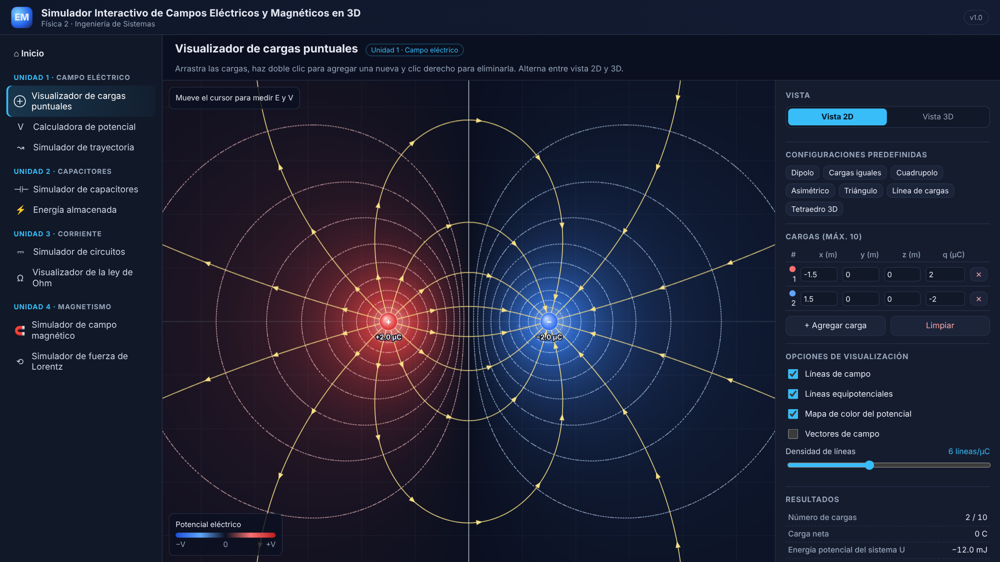

# Simulador Interactivo de Campos Eléctricos y Magnéticos en 3D

Aplicación web interactiva para el curso de **Física 2** (Ingeniería de Sistemas). Visualiza en tiempo real campos eléctricos de distribuciones de carga, líneas y superficies equipotenciales, trayectorias de partículas cargadas en campos eléctricos y magnéticos, capacitores con dieléctricos y circuitos de corriente continua.



## Cómo usarlo

**Sin instalar nada:** abre `dist/index.html` con doble clic en Chrome, Edge o Firefox. Es un único archivo autocontenido que funciona sin conexión a internet.

**Para desarrollar:**

```bash
npm install          # instala three.js y esbuild
npm run build        # genera dist/index.html
npm test             # ejecuta las 29 pruebas unitarias del núcleo físico
npm run validar      # validación numérica contra NumPy/SciPy (requiere Python 3)
```

## Módulos (organizados por unidad)

| Unidad | Módulo | Qué hace | Método numérico |
|---|---|---|---|
| 1 · Campo y potencial eléctrico | Visualizador de cargas puntuales | Hasta 10 cargas en 2D y 3D: líneas de campo, equipotenciales, mapa de V, superficies equipotenciales 3D | Superposición de Coulomb, trazado de líneas con RK4, *marching squares* y *marching cubes* |
| | Calculadora de potencial | V, E y contribución de cada carga en un punto P(x, y, z); desarrollo paso a paso; V(x) y \|E\|(x) | Suma directa |
| | Simulador de trayectoria | Partícula lanzada entre placas paralelas (comparada con la solución analítica) o entre cargas puntuales | Runge-Kutta 4 de paso adaptativo |
| 2 · Capacitores y dieléctricos | Simulador de capacitores | C según A, d y dieléctrico; batería conectada (V cte.) o aislada (Q cte.); ruptura dieléctrica | C = κε₀A/d, dieléctrico parcial en paralelo |
| | Energía almacenada | U = ½CV² como área bajo la recta Q–V; asociación serie/paralelo | — |
| 3 · Corriente y ley de Ohm | Simulador de circuitos | Editor sobre malla: resistores, fuentes, capacitores y cables; V, I y P de cada componente | Análisis nodal modificado (MNA) + eliminación gaussiana |
| | Visualizador de la ley de Ohm | V, I, R en tiempo real; curva I–V de resistor, lámpara y diodo | Bisección (diodo), punto fijo (lámpara) |
| 4 · Fuerza y campo magnético | Simulador de campo magnético | Líneas de B de hilo, dos hilos, espira, Helmholtz, solenoide e imán; sonda con comparación analítica | Biot-Savart por segmentos + RK4 |
| | Fuerza de Lorentz | Círculo, hélice, cicloide E×B, selector de velocidades, espectrómetro de masas | Empujador de Boris (leapfrog) |

## Arquitectura

```
src/
├── core/                 Núcleo físico puro (sin interfaz, probado con node:test)
│   ├── constants.js      Constantes CODATA 2018
│   ├── electrostatics.js Coulomb, superposición, energía del sistema
│   ├── integrators.js    RK4, Euler, Boris
│   ├── fieldlines.js     Trazado de líneas de campo
│   ├── contour.js        Marching squares (equipotenciales)
│   ├── circuit.js        Solucionador MNA de circuitos
│   ├── magnetostatics.js Biot-Savart y expresiones analíticas
│   └── capacitor.js      Capacitores y dieléctricos
├── ui/                   Componentes de interfaz reutilizables
│   ├── dom.js            Controles (deslizadores, tablas, etc.)
│   ├── plot.js           Gráficas 2D en canvas
│   ├── scene3d.js        Escena Three.js con cámara orbital
│   └── layout.js         Plantilla común de cada módulo
├── modules/              Un archivo por módulo (u1-…, u2-…, u3-…, u4-…)
├── state.js              Estado compartido (distribución de cargas)
└── main.js               Navegación y página de inicio
tests/                    Pruebas unitarias (29)
validacion/               Validación con NumPy/SciPy y figuras
scripts/build.mjs         Empaquetado en un único HTML
```

El núcleo físico (`src/core`) no depende del navegador: se puede probar y reutilizar por separado. Cada módulo de interfaz expone `mount(contenedor)` y devuelve `dispose()`, de modo que agregar un módulo nuevo solo requiere registrarlo en `src/modules/index.js`.

## Pruebas y validación

- `npm test`: 29 pruebas unitarias (ley de Coulomb, E = −∇V, orden de RK4, conservación de energía con Boris, leyes de Kirchhoff, Biot-Savart, ∇·B = 0, etc.).
- `npm run validar`: compara el simulador con soluciones de referencia independientes (SciPy `solve_ivp` DOP853, integrales elípticas para la espira, análisis de mallas con NumPy, solución analítica de la cicloide). Resultados en `validacion/resumen.md` y figuras en `validacion/figuras/`.

## Tecnologías

JavaScript (ES2020), [Three.js](https://threejs.org) para 3D, Canvas 2D para gráficas, esbuild para empaquetar, Node.js para pruebas, Python (NumPy, SciPy, Matplotlib) para la validación.

## Licencia

MIT. Ver `LICENSE`.
